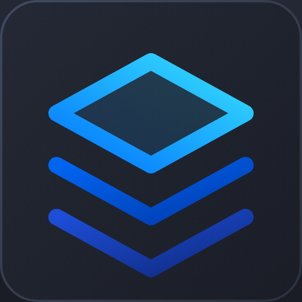

#  HVL Family Office

Household financial planning, tax projection, equity compensation, and Monte Carlo scenario modeling application—built for **local desktop execution (`LOCAL_MODE=1`)** or **self-hosted multi-tenant cloud deployment (`LOCAL_MODE=0`)**.

- **Web Portal & Interactive Demo Sandboxes**: **[finances.highvelocitylabs.dev](https://finances.highvelocitylabs.dev)**
- **Technical Reference & Download Guide**: **[finances.highvelocitylabs.dev/features](https://finances.highvelocitylabs.dev/features#download)**
- **Scenario Planning Playbooks**: **[finances.highvelocitylabs.dev/playbooks](https://finances.highvelocitylabs.dev/playbooks)**
- **User Guide, Setup Manual & Knowledge Base**: **[finances.highvelocitylabs.dev/help](https://finances.highvelocitylabs.dev/help)**
- **Security & Privacy Policy**: **[SECURITY.md](SECURITY.md)**

---

## Core Capabilities & Engines

- **Multi-Source Account, Holdings & Balance History Sync**:
  - **SimpleFIN Bridge**: Direct read-only token sync with 16,000+ North American institutions (`beta-bridge.simplefin.org`) with 90-day transaction balance reconstruction.
  - **Monarch Money**: Headless GraphQL account, ticker holding, and historical balance snapshot sync with AES-256 Fernet encrypted SQLite token persistence (no plaintext `.pickle` session files on disk).
  - **Manual & CSV Balance History**: Direct account/holding entry plus CSV balance history import/export (`Date, Account, Balance` or multi-column tables) with carry-forward gap interpolation.
- **Multi-Year RSU, ISO & NSO Equity Modeling (`equity_engine.py`, `forecast/waterfall_equity.py`)**:
  - Models vesting schedules, refresh grant stacking, 4 scenario holding, exercise & exit strategies (**Cashless Repurchase**, **Exercise & Hold with Cash**, **Exercise & Hold with Sell-to-Cover**, and **Sell Held Shares Later** at long-term capital gains, NIIT, and WA state capital gains rates above the stepped-up cost basis), staged multi-year tranches, per-scenario equity growth overrides, statutory supplemental withholding rates vs. marginal tax liability, and quarterly estimated tax safe-harbor schedules.
- **AI Financial Advisor, Personal Assistant MCP Gateway & Siri Voice Webhook (`services/advisor/`, `routes/mcp.py`, `routes/siri.py`)**:
  - Conversational scenario and assumption modeling (branching/updating/resetting child scenarios, comparing company equity exercise strategies, and drilling into annual cash-flow waterfalls) with multimodal file/image chat attachments, external MCP client support (`POST /mcp`), token-wrapped Siri Shortcuts voice queries (`POST /api/siri`), and a unified Notification Center with household health alerts and optional `VAPID` lock-screen Web Push.
- **Federal + 50-State Statutory Tax Engine & PDF Ingestion (`tax_engine.py`)**:
  - Computes federal and state income tax brackets, FICA/Medicare, NIIT (3.8%), AMT, capital gains, and quarterly safe-harbor targets.
  - Parses IRS Tax Return/Wage Transcripts and Form W-2 PDFs in-memory (`io.BytesIO`, never written to disk) to populate prior-year actuals and safe-harbor baselines.
- **Vectorized Monte Carlo, 1928–2025 Historical Cohort Backtesting & Retirement Simulator (`forecast/`)**:
  - Simulates multi-decade trajectories across Taxable, Pre-Tax (`401k`/`IRA`), and Tax-Free (`Roth`) pools using both 1,000-trial parametric Monte Carlo and rolling 1928–2025 historical S&P 500/Treasury/CPI cohorts (`forecast/historical_cohorts.py`).
  - Supports branching scenario trees with two-way HTML5 drag-and-drop plan reordering (`cards_reorder.js`, `POST /api/scenarios/reorder`), non-destructive scenario archiving (`services/scenario_archive_service.py`) with 1-click `Show/Hide Archived` toggling, single-year horizontal Cash-Flow Sankey diagrams, Roth conversion ladders, 529 college funding waterfalls, Pre-65 ACA healthcare bridges, IRS Rule 72(t) SEPP distributions, age-65 Medicare IRMAA surcharges, RMDs, and per-plan dynamic spending guardrails.
- **Estate, Crummey Gifting & DAF Philanthropy**:
  - Tracks federal/state lifetime estate exemptions, annual exclusion gifting ledgers, appreciated-lot Donor-Advised Fund (DAF) contributions, and beneficiary role mapping.
- **Interactive Ephemeral Web Sandbox (`/sandbox`) & Pre-Seeded Demo Personas (`/demo`)**:
  - **No-Login Interactive Web Sandbox (`/sandbox`)**: Visitors can launch an isolated, editable sandbox household (seeded with sample data, blank, or restored from a `.fovault` file) encrypted with a browser-cookie-only key (`encryption_key_enc = NULL` on disk) and automatically wiped after 24 hours (with 1-click **Save for 7 Days**, **Wipe Now**, and `.fovault` download/upload).
  - **Read-Only Demo Personas (`/demo`)**: Six pre-seeded synthetic households are available in read-only demo mode at **[finances.highvelocitylabs.dev/features#demos](https://finances.highvelocitylabs.dev/features#demos)**:
    1. **The Jones Family** (San Francisco, CA) — Dual W-2 earners (Tech + Physician), 3 children, NSO/RSU equity grants, CA marginal tax modeling.
    2. **The Miller Family** (Seattle, WA) — Early-retired (FIRE), `$6.5M` liquid index portfolio, 0% WA state income tax, Roth conversion ladder.
    3. **The Chen Family** (New York, NY) — Series A founder, ISO/AMT exercise planning, NYC real estate, 529 superfunding.
    4. **The Ramirez Family** (Austin, TX) — High school teacher + master electrician (`$150k` HHI), mortgage & auto loan amortization, Texas 529 plans.
    5. **The Taylor Family** (Columbus, OH) — Registered nurse + warehouse supervisor (`$126k` HHI), student loan payoff, 401(k) match & emergency fund building.
    6. **The Foster Family** (Denver, CO) — Single parent & pediatric physical therapist, Head of Household filing, Colorado 529, 403(b) & Roth IRA.

---

## Privacy, Security & Multi-Tenant Architecture

### 1. Local Desktop Execution (`LOCAL_MODE=1` Default)
- **Offline Execution**: When run as a desktop application (macOS `.dmg` / Windows `.exe`) or via Docker (`LOCAL_MODE=1`), all calculations, scenario modeling, and database storage execute locally on `127.0.0.1`.
- **Local SQLite Vault**: Databases reside on your local drive (`~/Library/Application Support/HVLFamilyOffice` on macOS, `%LOCALAPPDATA%\HVLFamilyOffice` on Windows).
- **Zero Third-Party Analytics**: No third-party analytics scripts (no Google Analytics, Mixpanel, or Meta Pixel) and no background phone-home telemetry.

### 2. Physical Database-per-Household Multi-Tenancy
- **Isolated SQLite Files**: In cloud multi-tenant mode (`LOCAL_MODE=0`), every household is stored in a separate SQLite database file (`data/families/{family_id}.db`), distinct from the global directory database (`data/global.db`).
- **Per-Family Cache & Job Isolation**: L2 forecast caches and background job queues are similarly isolated per household (`data/families/{family_id}_cache.db`).

### 3. Zero-Knowledge Cloud Key Escrow & Support Lock
- **Client-Held Encryption Keys**: In hosted cloud deployments (`LOCAL_MODE=0`), each household's 256-bit Household Encryption Key (HEK) is stored in the user's private Google Drive `appDataFolder` (`drive.appdata`) and encrypted browser cookie (`__Host-hvl_vault_fek`).
- **Cryptographic Support Lock**: When **Allow Support Access** is `OFF` (the default), `families.encryption_key_enc` is `NULL` on the server. Out-of-band CLI or database inspection raises `PermissionError: Household vault is cryptographically locked`.

### 4. Column-Level AES-256 Fernet Encryption at Rest
- SQLAlchemy 2.0 Declarative ORM (`db/models.py`) encrypts sensitive columns (names, balances, compensation, equity grants, API tokens, notes) at rest using `EncryptedString`, `EncryptedFloat`, `EncryptedInt`, and `EncryptedJSON` (`db/types.py`) backed by per-household AES-256 Fernet keys (`PBKDF2-HMAC-SHA256`, 600,000 iterations).

### 5. AI Advisor Privacy & Bring-Your-Own Key (BYO Key)
- **PII Stripping**: Context sent to the AI Advisor strips personal names and account numbers, passing only category totals and ticker symbols.
- **Optional BYO Gemini Key**: Users can store their own Gemini API key encrypted inside their household vault in **Settings → Account Connections**, or leave AI features unconfigured without affecting deterministic engines.

---

## 3 Ways to Run HVL Family Office

### 1. Standalone Desktop App (macOS `.dmg` & Windows `.exe`)
Download the latest release from **[GitHub Releases](https://github.com/High-Velocity-Labs/hvl-family-office/releases)**:
- **macOS (Apple Silicon `.dmg`)**: Open `HVL-Family-Office-macOS.dmg`, drag **HVL Family Office.app** to `/Applications`, and launch. *(If macOS Gatekeeper prompts on first launch, right-click the app in `/Applications` → **Open**, or run `xattr -cr "/Applications/HVL Family Office.app"`).*
- **Windows (64-bit `.exe` Installer)**: Run `HVL-Family-Office-Windows-Setup.exe` (installs in user-space under `%LOCALAPPDATA%\Programs\HVL Family Office` without requiring Administrator elevation).
- **First Launch**: Set a local **Passphrase or PIN** (4–128 characters) to initialize your AES-256 encrypted household vault, then follow the **6-Step Guided Setup Wizard**.

#### Cryptographic Build Provenance Verification (SLSA)
Official macOS `.dmg` and Windows `.exe` releases built on public GitHub Actions runners include **GitHub Artifact Attestations (SLSA Build Provenance)** and `SHA256SUMS.txt`:
```bash
# Verify macOS disk image provenance via GitHub CLI
gh attestation verify HVL-Family-Office-macOS.dmg --owner High-Velocity-Labs

# Verify Windows installer provenance via GitHub CLI
gh attestation verify HVL-Family-Office-Windows-Setup.exe --owner High-Velocity-Labs

# Or verify SHA-256 checksums against SHA256SUMS.txt
shasum -a 256 -c SHA256SUMS.txt
```

### 2. Local Mode via Docker or Python (`LOCAL_MODE=1`)
Run locally from source or Docker without configuring Google OAuth:

#### Option A: Docker Compose
```bash
git clone https://github.com/High-Velocity-Labs/hvl-family-office.git
cd hvl-family-office
docker compose up -d --build
# Open http://localhost:5050 in your browser
```

#### Option B: Local Python Environment (Python 3.11+)
```bash
git clone https://github.com/High-Velocity-Labs/hvl-family-office.git
cd hvl-family-office
python3 -m venv .venv
source .venv/bin/activate  # Windows: .venv\Scripts\activate
pip install -r requirements.txt

# Launch the local desktop server and open browser
python desktop_app.py
```

### 3. Multi-Tenant Cloud Server (`LOCAL_MODE=0`)
To host a multi-household deployment behind Nginx/Gunicorn with Google OAuth 2.0 and Google Drive `appDataFolder` key escrow:
```bash
cp .env.example .env
# Edit .env: set LOCAL_MODE=0, ADMIN_EMAIL, GOOGLE_CLIENT_ID, GOOGLE_CLIENT_SECRET,
# APP_ENCRYPTION_KEY, and FLASK_SECRET_KEY
gunicorn --bind 127.0.0.1:5050 --workers 2 --threads 4 wsgi:app
```

---

## Building the Standalone Desktop Installer from Source

To compile your own standalone `.app` / `.dmg` (macOS) or `.exe` installer (Windows):

```bash
pip install -r requirements.txt pyinstaller waitress pystray pillow
python scripts/build_desktop.py
```
- **macOS Output**: `dist/HVL Family Office.app` and `dist/HVL-Family-Office-macOS.dmg`
- **Windows Output**: `dist/HVL-Family-Office/HVL-Family-Office.exe` (and `dist/HVL-Family-Office-Setup.exe` when [Inno Setup 6](https://jrsoftware.org/isinfo.php) is installed)

---

## Configuration Reference (`.env` & Environment Variables)

All settings have defaults for `LOCAL_MODE=1`. Copy [`.env.example`](.env.example) to `.env` to customize ports, data directories, or cloud OAuth credentials:

| Variable | Default | Description |
| :--- | :--- | :--- |
| `LOCAL_MODE` | `1` (Desktop/Docker) | `1` enables single-household Local Mode (offline PIN/Passphrase unlock, `.fovault` backup/restore). `0` enables multi-tenant Cloud Server mode. |
| `FAMILY_OFFICE_PORT` | `5050` | TCP port for the local Waitress/Flask server. |
| `FAMILY_OFFICE_DATA_DIR` | OS AppData path | Overrides where SQLite databases (`global.db`, `families/1.db`), `.mm/.secret.key`, and `backups/` are stored. |
| `FAMILY_OFFICE_HEADLESS` | `0` | Set to `1` (or pass `--headless`) to run `desktop_app.py` as a background daemon without opening a browser window. |
| `GEMINI_API_KEY` | *(In-App Settings)* | Google Gemini API key for the AI Financial Advisor and W-2/IRS Transcript PDF extraction. In Cloud Mode (`LOCAL_MODE=0`), `.env` acts as the shared fallback key (`5/min, 30/hr, 2,000 chars`); households with their own BYO key in **Settings → Account Connections** (and all `LOCAL_MODE=1` desktop installs) use `30/min, 300/hr, 8,000 chars`. |
| `ADMIN_EMAIL` | *(None)* | Cloud Mode (`LOCAL_MODE=0`) Super-Admin email that claims Household #1 and can generate Magic Invites. |
| `GOOGLE_CLIENT_ID` | *(None)* | Google OAuth 2.0 Client ID (required for Cloud Mode; optional in Local Mode). |
| `GOOGLE_CLIENT_SECRET` | *(None)* | Google OAuth 2.0 Client Secret. |
| `APP_ENCRYPTION_KEY` | Auto (`.mm/.secret.key`) | 32-byte URL-safe base64 Fernet root key. Automatically generated and persisted on first run in Local Mode. |
| `FLASK_SECRET_KEY` | Auto-generated | 64-character hex secret for signing HTTP session cookies. |

---

## Data Storage, Backups, Upgrades & PIN Recovery

- **Default Local Vault Directory**:
  - **macOS**: `~/Library/Application Support/HVLFamilyOffice/`
  - **Windows**: `%LOCALAPPDATA%\HVLFamilyOffice\`
  - **Linux / Docker**: `~/.local/share/hvl-family-office/` (or `/app/data` volume)
- **Single-File `.fovault` Backups & Restore**:
  - In **Settings → Household & Access → Local Desktop Vault**, click **Backup (`.fovault`)** to download a consistent, AES-256 encrypted single-file snapshot of your household database, or **Restore (`.fovault`)** to import a backup on another machine.
- **In-Place App Upgrades**:
  - Installing a newer `.dmg` or `.exe` (or running `git pull`) preserves your data directory. On first launch of a new version, `desktop_app.py` stops any older background daemon, creates a timestamped `backups/pre_upgrade_vX_to_vY.fovault` snapshot, and applies schema migrations in-place.
- **Changing or Recovering a Forgotten PIN**:
  - Change your PIN while logged in under **Settings → Change PIN / Passphrase**.
  - Click **Copy Recovery Key** in Settings to save your local recovery token (`.mm/.secret.key`) in a password manager. If you forget your PIN on `/login`, paste that Recovery Key to set a new PIN without data loss.

---

## Verification & Security Audit Suite

```bash
# Run the adversarial security, encryption-at-rest, and zero-PII audit
python scripts/audit_security_and_data.py

# Run the automated pytest suite
python -m pytest tests/
```

---

## Legal Disclaimer & Limitation of Liability

### 1. Not Financial, Investment, Tax, or Legal Advice
HVL Family Office is personal financial modeling and scenario simulation software developed for educational, research, and personal household informational purposes only. It is **not** certified financial, investment, tax, legal, or accounting advice.
- Mathematical calculations, statutory tax bracket estimates, RSU withholding waterfalls, and Monte Carlo projections are algorithmic approximations based on user-supplied assumptions and historical data. They do not constitute financial recommendations or guarantees of future returns.
- High Velocity Labs, its creators, maintainers, and contributors are not registered investment advisors (RIAs), broker-dealers, fiduciaries, or certified tax preparers.
- Always consult a qualified Certified Financial Planner (CFP®), Certified Public Accountant (CPA), or tax attorney before making investment, retirement, equity exercise, or tax filing decisions.

### 2. "AS IS" Software & Zero Data Breach / Leak Liability
- **No Warranty**: As detailed in the [LICENSE](LICENSE) and [Master Terms](https://highvelocitylabs.dev/terms), this software, source code, installers, and all hosted demo/cloud instances are provided strictly on an **"AS IS"** and **"AS AVAILABLE"** basis without warranties of any kind, express or implied.
- **Zero Breach or Leak Liability**: While security, encryption at rest, and access controls are implemented in good faith, no software, computer, or internet service is invulnerable. **Under no circumstances shall High Velocity Labs, the creators, maintainers, contributors, or server operators be liable for any data breaches, unauthorized access, hacking, data leaks, accidental disclosures, data loss, database corruption, or software errors**, whether arising from local desktop execution, self-hosting, or access to hosted cloud instances.
- **Assumption of Risk**: By downloading, installing, running, or accessing HVL Family Office, you expressly agree that you use the software at your own risk and that you release the creators and contributors from any and all claims, damages, or liabilities whatsoever.

---

## License & Support Policy

- **License**: Licensed under the **[PolyForm Noncommercial License 1.0.0](LICENSE)**. Free for personal household use, self-hosting, and noncommercial experimentation. Commercial use (including hosted SaaS offerings or use by financial advisory/wealth management practices) requires a separate commercial license from **[High Velocity Labs](https://highvelocitylabs.dev)** (`hello@highvelocitylabs.dev`).
- **Security Disclosures & Contributions**: Shared **as-is** with no warranty or SLA. See **[CONTRIBUTING.md](CONTRIBUTING.md)** for contributor guidelines and security vulnerability reporting (`privacy@highvelocitylabs.dev`).
- **Master Terms of Service**: Governed by the **[High Velocity Labs Terms of Service](https://highvelocitylabs.dev/terms)**.
